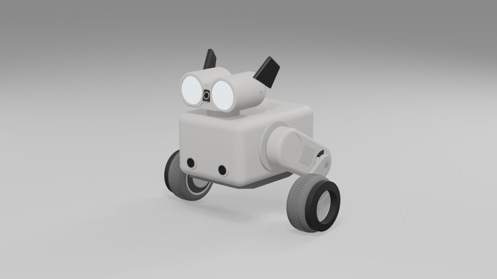

# BiPe

BiPe is a small wheeled biped: two legs, a wheel at the end of each, and a
binocular head pod. It balances on its wheels, drives, turns, crouches and
stands, gets back up after a fall, and can follow a person wearing an
AprilTag. It is about 1.8 kg.



The robot was designed in full before anything is built: CAD with real parts,
circuit boards, firmware, a physics model and two controllers (a classical
one and a learned policy). **Everything here is simulation and design.
Nothing has been built or powered yet.** Results are labelled by what they
are: a layout study, a validated simulation under stated assumptions, or
(later) a hardware result.

The project takes its direction from open, sim-first robots such as Pollen
Robotics' [Microduck](https://github.com/pollen-robotics/microduck): train in
simulation, export a small policy, and publish the recipe so anyone can rerun
it.

## What it can do in simulation

All results are on the full MuJoCo plant: free base, finite motor limits,
physical contact, belt and gear lash, sensor delays and noise, and the same C
firmware the robot runs.

| Area | Result |
|---|---|
| Balance, drive, turn, crouch | A 107-case acceptance suite: pushes, belt and gear lash, mass and friction changes, motor lag, sensor delay and noise, slopes. Classical controller: all 70 robustness-matrix cases and 25 of 27 scenario cases. |
| Speed | 1.2 m/s, 1.25 m/s², 1.0 rad/s turns, 0.3 m/s reverse, on a 44-case speed suite. |
| Falls | Forward and backward tips keep a structural factor of at least 2.06 on every load path. |
| Electronics | Six moteus-c1 drivers on CAN-FD, a Teensy 4.0 carrier, power board; 3.44 ms of the 5 ms control budget; 28–39 min runtime. |
| Person following | Rendered camera frames in the loop with AprilTag detection: 60/60 nominal runs and 101/112 overall, no falls on the nominal plant. |
| Learned policy | Trained with mjlab on MuJoCo Warp. Recovers 89/98 acceptance cases (classical 83/98), all 30 pushes, all 8 belt-range cases, no physical failures. Exported to ONNX and a 48k-parameter C forward pass that matches within 6.3e-7. |
| Get-up | A second policy gets the robot up from a sit or a front or back lean and hands over to the locomotion policy, including from flat on the face or back (M17: legs to their stops for 0.5 s first): 59/60 held-out randomised falls (sit 20/20, front 20/20, back 19/20) and 40/40 on a fresh set. |
| Sit and stand | A third policy sits the robot down on its shell and stands it up again: 40/40 randomised cycles, each ending within 1.34 mm of the commanded height. |
| Moves and following with the policy | Three expressive moves (crouch bob, spin and stop, wiggle) pass 3/3 nominal and 21/21 variants. Following with the policy: 60/60 nominal runs and 48/52 robustness runs. |

Known gaps are kept in view: the policy passes 35 of 43 speed cases (the
target is 40), the stress suite falls 5.9 % of the time (the target is 5 %),
the get-up still misses one held-out start (flat on the back with low grip,
1 of 60) and cannot recover a robot on its side, and neither the get-up nor the sit has had a structural
falls screen yet. See [docs/results.md](docs/results.md) for the full numbers,
what each one measures, and what is still open.

The classical controller is the power-up default. The learned policy is
selectable and becomes the default only after a bench check on real
hardware.

## Quick start

Linux, Python 3.12 and [uv](https://docs.astral.sh/uv/):

```bash
git clone https://github.com/pranay172/BiPe.git bipe && cd bipe
uv venv .venv --python 3.12
uv pip sync requirements.lock --python .venv/bin/python
export PYTHONPATH=.
.venv/bin/python -m bipe sim        # drive it yourself
```

`bipe sim` opens BiPe in a MuJoCo window, driven by its learned policies on a
CPU. The arrow keys drive and turn, Page Up and Page Down stand taller and
crouch, End sits, Insert stands (or gets up after a fall), Enter pushes it and
F8 knocks it over. `--start sit`, `front_lean` or `back_lean` starts on the
floor, and `python -m bipe sim --help` lists every key. Without a display,
`python -m bipe sim --headless` runs a scripted tour (drive, turn, push, a move,
sit, stand, a fall and a get-up) and prints a verdict for each step.

The sim runs the policies on the lighter training plant, faster than real
time, with exact sensors. Every result in the table above is from the full
plant instead. To record a full-plant shot,

```bash
.venv/bin/python -m bipe.demo record push_recovery     # classical controller, about 2 min
```

writes `local/demo/push_recovery_classical.npz` (standing, then pushes from
behind and in front). To render it to video, to run the learned policy in the
full plant, the test suite or the acceptance cases, see
[docs/getting-started.md](docs/getting-started.md).

## Repository

| Path | What is there |
|---|---|
| `bipe/` | Python: plant, controllers, test suites, RL environment, demo tools |
| `firmware/` | C core (estimator, balance, follower, policy forward pass) and the Teensy images |
| `config/` | Robot dimensions, masses, limits, controller and sensor settings (SI) |
| `cad/` | FreeCAD scripts that build the assembly |
| `electronics/` | KiCad boards |
| `artifacts/` | Generated records: CAD, renders, simulation results, exported policies |
| `docs/` | Milestone plans and results, hardware plan, studies |
| `tests/` | pytest suite |

More detail in [docs/repository-layout.md](docs/repository-layout.md).

## Documentation

- [Getting started](docs/getting-started.md): install, run, render, train.
- [Results](docs/results.md): what the simulations show, and the open gaps.
- [Repository layout](docs/repository-layout.md).
- [Development pipelines](docs/development.md): CAD, boards, firmware
  builds, renders.
- [Behaviours](docs/behaviours.md): one card per behaviour, with its
  limits; the [policy contract](docs/policy-contract.md) they share; the
  [training playbook](docs/training-playbook.md).
- [Milestone log](docs/milestones/README.md): the full plans and records,
  M10 to M17.
- [Hardware build plan](docs/hardware/build-plan.md) and
  [bill of materials](docs/hardware/bom.csv): about $3,600 with a
  single-leg test rig and spares. Nothing is bought yet.

## Roadmap

1. **Done:** M10 to M17, ending with a behaviour set on one policy contract
   (drive, get up, sit and stand, three moves, following), the `bipe sim`
   front door, and get-up from flat on the face or back (November 2026).
2. **Next:** the public release (policies on the Hugging Face Hub, a browser
   replay).
3. **Hardware:** bench timing, a single-leg rig with system identification,
   a tethered robot (classical first, then the policy), then retraining on
   measured parameters.

## Licence

- Code, firmware, configuration and scripts: [Apache-2.0](LICENSE).
- CAD models, renders, simulation records and documentation:
  [CC BY-SA 4.0](LICENSE-CAD).
- Circuit boards: [CERN-OHL-P-2.0](LICENSE-HARDWARE).

[NOTICE](NOTICE) has the exact scope of each licence and the third-party
attributions (mjbots moteus protocol, KiCad footprints).

## Acknowledgements

- BiPe's look and proportions were inspired by Beni, the small wheeled camera
  robot by [Mondo Robotics](https://www.mondorobotics.com/). BiPe is an
  independent project, not affiliated with or endorsed by Mondo Robotics. No
  Mondo designs or CAD were used; the exterior was drawn from public imagery.
- The sim-first approach follows Pollen Robotics'
  [Microduck](https://github.com/pollen-robotics/microduck): train in
  simulation, export a small policy, and publish the recipe.
