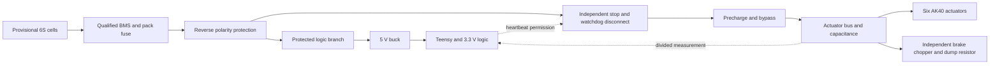
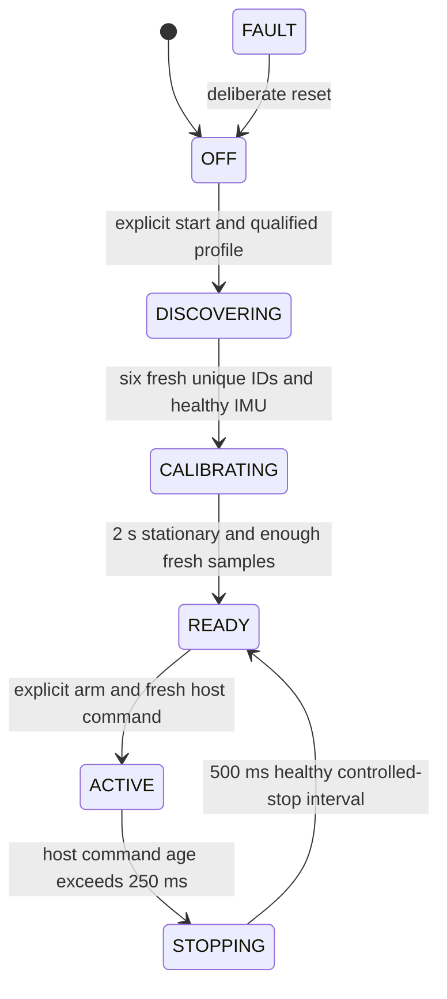

# Electronics and firmware engineering notes

The M4 implementation is a **digital controller-carrier candidate and tested portable firmware core**. It is not yet an electrically qualified complete robot. Exact AK40 driver parameters and the external actuator power assembly remain release gates. The delivered Teensy image is diagnostic only and cannot energize motors.

## Shared configuration and selected logic

`config/robot.json` remains the physical SI model. The existing 90 g electronics allocation and its CAD inertia remain in simulation; the board estimate does not silently replace them. `config/electronics.json` defines electrical assumptions, pins and timing; `config/actuator-profile.json` deliberately contains null exact-variant parameters and false qualification fields. Generated C constants include hashes of these files and the accepted moving controller.

| Component | Selection and basis | Boundary |
| --- | --- | --- |
| MCU | [PJRC Teensy 4.0](https://www.pjrc.com/store/teensy40.html), 600 MHz Cortex-M7, native CAN controller | External transceiver required; 3.3 V inputs are not 5 V tolerant. VIN 3.6–5.5 V. Cut the manufacturer's VUSB/VIN link before externally powered USB use. No module has been modified or flashed. |
| IMU | [ST LSM6DSOTR](https://www.st.com/resource/en/datasheet/lsm6dso.pdf), raw LGA14, SPI clock mode 3, 833 Hz, ±4 g / ±500 °/s | Mounting transform, bias, filters, sample timing and vibration performance need commissioning. |
| CAN | [TI TCAN330D](https://www.ti.com/lit/ds/symlink/tcan330.pdf), 3.3 V SOIC8 | The CAN pins' ±14 V absolute range does not tolerate a short to the battery. Harness fault and EMC protection remain open; internal ESD ratings do not solve that fault. |
| Logic supply | [Pololu D24V22F5 #2858](https://www.pololu.com/product/2858), 5 V output, 36 V maximum input | Manufacturer's typical current capability depends on input and thermal conditions. The 150 mA logic-load budget is assumed. PG is open-drain pulled to 3.3 V; EN stays unconnected, never driven directly by the MCU. |
| Connectors | [JST PH side-entry SMT](https://www.jst-mfg.com/product/pdf/eng/ePH.pdf), S3B/S4B-PH-SM4-TB | These low-current interfaces do not carry motor power. Actuator connector pin order is unqualified. |

The [BOM](../../electronics/bom.csv) lists candidate MPNs, footprints and manufacturer sources. Passive MPN availability, ceramic DC-bias derating, assembled masses and outsourcing tolerances remain procurement checks. Manufacturer snapshots and retrieval notes are in [the source manifest](../../artifacts/milestone-4/component-sources/manifest.json). The ST PDF was reviewed online; its direct download timed out. Its official register header is saved locally.

## Power architecture and outstanding assembly

The complete power assembly still needs a component-level schematic/BOM/layout, electrical qualification, protection coordination and integration within the remaining envelope/mass. Its diagram and SPICE decks establish requirements, not a fabricated or fully selected circuit.

Keep logic available upstream of actuator disconnection so faults can be reported. The stop switch and an independent watchdog must interrupt actuator power without relying on firmware or CAN. The MCU's STOP_N input only monitors a fail-open loop. A future hardware heartbeat must expire when execution stalls; a steady high RUN signal is insufficient. The diagnostic image keeps this line low. The portable supervisor's power-request boolean is a logical permission, not an implemented external watchdog.

Place brake chopper and bus capacitor downstream of the disconnect; provide the clamp comparator/gate driver with a source that survives battery/BMS removal. Cutting the battery connection does not remove energy regenerated by moving motors. Coordinate BMS charge rejection, fuse, reverse-polarity path, discharge/precharge, switch SOA, harness inductance, capacitance, TVS and resistor pulse/continuous ratings. BMS discharge current, motor phase current and pack DC current are different quantities. The M3 mechanical traces alone cannot determine exact electrical current without motor/driver efficiency and torque scaling.

The provisional pack is 6S P28A, 21.6 V nominal / 25.2 V full. The AK40 product lists 24 V nominal but does not establish that 25.2 V plus transients is permitted. **Direct 6S connection and all actuator-bus limits remain unapproved.** The 18–27 V supervisor limits and 26/25.6 V clamp thresholds are explicit test assumptions. A generic larger AK driver voltage range is not evidence for this AK48 board.

The [ngspice analysis](../../artifacts/milestone-4/power/report.json) uses a 1 mF bus, assumed 0.15 Ω pack resistance and a 1 A / 80 ms regeneration pulse. A behavioral hysteretic switch with a 50 μs RC lag and 22 Ω dump load predicts a 26.052 V peak with the battery open. This is below the conditional 28 V study ceiling, not a confirmed actuator rating. The dump dissipates 2.056 J. The ideal unclamped negative control reaches 105.2 V; real components would fail earlier. The connected-pack case assumes the battery accepts regeneration, which a full pack/BMS may reject. This is not worst-case electrical/thermal validation.

An unloaded precharge study uses 100 Ω and reaches 99% bus charge in 0.461 s, before a modeled bypass at 0.5 s. Initial current is about 252 mA, resistor peak power 6.33 W and pulse energy 0.317 J. Real actuator startup load is absent: qualify it and require measured bus readiness before bypass, rather than using a fixed delay alone.

The ADC divider is 100 kΩ / 10 kΩ with 10 nF at the sense node. The nominal full-pack input is 2.291 V; at a modeled 30 V bus with worst opposing 1% resistor errors it is 2.777 V. Its analytic cutoff is 1.751 kHz, and SPICE gives 1.738 kHz. Source impedance is 9.09 kΩ. The 100 MΩ ADC loading model omits acquisition/sample-and-hold behavior; qualify sampling time, reference error and transient protection before using thresholds as calibrated measurements.

## Carrier and interfaces

The native KiCad 9 project is [bipe-controller.kicad_pro](../../electronics/bipe-controller.kicad_pro). It has self-contained symbols and footprints, a routed two-layer 66 × 60 × 1 mm board, four provisional M2 mounting holes and filled ground copper. It fits within the reserved 70 × 64 mm XY allocation. ERC, all-severity DRC and schematic parity report zero violations/unconnected nets. Minimum copper clearance is 0.15 mm; zone clearance is 0.2 mm, track width 0.2 mm, via diameter/drill 0.6/0.3 mm. These are manufacturing assumptions for later fabricator review.

The buck's documented bottom projection, board and top components give a nominal stack of 1.0 + 1.3 + 1.02 + 6.0 = 9.32 mm when directly soldered on spacers. This is only a stack-up study inside the 10 mm allocation. No tall module sockets are allowed by that study. Module tolerance, insulation, connector plugs, USB access, solder protrusions and the final housing mounting geometry still need 3D integration. The M3 CAD is preserved; this board has not been substituted into its mass model or counted as a completed fit/thermal review.

The carrier estimate is 42 g: board/copper 11.5 g, Teensy 4 g, buck 2.5 g, ICs/passives/connectors 12 g, mounting/logic wire 12 g. This leaves 48 g within the existing 90 g allocation for the unresolved external power assembly. These are allowances, not weighed parts. Pack construction already has a separate 50 g allocation in M3; avoid counting its BMS twice. The complete robot's existing 7.8 g margin remains tight.

| Connector | Pin sequence in schematic/footprint numbering | Use |
| --- | --- | --- |
| J1, J2 | 1 GND, 2 CAN_L, 3 CAN_H | CAN daisy chain; twisted H/L pair, short stubs, common reference |
| J3 | 1 GND, 2 LOGIC_BUS, 3 ACTUATOR_BUS_SENSE | Protected logic feed plus independent downstream-bus measurement |
| J4 | 1 GND, 2 RUN_HEARTBEAT, 3 STOP_N, 4 3.3 V | Future power-stage permission and monitored stop loop; never attach battery voltage |
| J5 | 1 GND, 2 ARM_N, 3 3.3 V | Service arm/start input; reset is a separate deliberate software action |

J5 only wires ARM_N; reset is not a connector signal.

Teensy pins: CAN TX/RX 22/23, silent 2; IMU CS/MOSI/MISO/SCK 10/11/12/13 and INT1 3; bus ADC 14; arm 4; stop 5; heartbeat permission 6; buck PG 7. The [pin audit](../../artifacts/milestone-4/electrical/pin-audit.json) records every mapped pin/net. The IMU has two local 100 nF bypass capacitors; unused auxiliary pins follow ST's mode-1 connections. CAN silent has a 10 kΩ pull-up and RUN has a 10 kΩ pull-down. JP1 is normally open; close it only if this controller is one of the two physical CAN endpoints. Verify actuator internal termination before assembling the complete bus.

## CAN protocol and timing

Use the documented V3.2 extended-ID family, not the older standard-ID MIT layout. Command function 8 uses `(8 << 8) | actuator_id`; eight data bytes contain Kp12, Kd12, position16, velocity12 and effort12 in that order. `firmware/src/protocol.c` implements this format. Golden test ranges are deliberately synthetic integers that make the expected packet `12 34 56 78 9A BC DE F0`; they must never become an AK40 profile. The codec uses representable maxima `2^bits−1`, avoiding the overflow at the upper endpoint in the manual's `2^bits` example. Exact driver interpretation still needs verification.

Function 0x29 feedback is decoded as signed 16-bit big-endian position at 0.1 degree, speed at 10 electrical RPM and Iq at 0.01 A, followed by signed temperature and error byte. The test conversion uses the product's 14 pole pairs and 10:1 reduction to express output rad/s. Error 0x77 is a disable acknowledgment, not healthy running feedback. The function-15 disable packet is implemented and byte-tested; no image here transmits it or any enable/zero/flash command.

The generic feedback position resolution is 0.1°, equivalent to 3,600 counts/revolution, even though the internal encoder is 16-bit. M4 therefore uses `config/sensors-m4.json` with 3,600 host counts and 65,536 modeled actuator-local counts. The actual multi-turn/wrap convention remains unqualified. The bounded modulo-one-turn reconstruction helper is tested synthetically, and must only be used if a profile explicitly proves that convention. A discontinuity or excessive sample gap must invalidate feedback; it must not be repaired by clamping state. Repeated equal positions can be valid stationary samples; timestamps advance only on actual new packets/data-ready events, not on each consumer tick.

Six commands and six feedback frames at 200 Hz, conservatively 160 bits/frame including stuffing/spacing, occupy 38.4% of a 1 Mbps bus. At 1 kHz in both directions they require 192%, which is impossible. The 1 kHz leg servo therefore remains actuator-local in the simulation. Exact local PD units, rate, feedforward mapping and command timeout are required before mapping M3 behavior onto hardware. Bus arbitration, FIFO overflow, error traffic and measured worst-case latency are future integration checks.

Joint signs and CAD zero conventions remain in [joint-conventions.md](joint-conventions.md). Each hardware actuator needs verified ID, sign, output-zero offset, reduction/current mapping and position limits. No automatic zero-write or stored calibration change is allowed by the diagnostic image. The IMU-to-body mounting transform is unqualified; its diagnostic norms do not establish a usable body-pitch estimate.

## Firmware state and execution boundaries

Fatal health/profile/deadline failures from a started state enter latched FAULT and remove torque permission and power request. OFF never arms from an arm request alone. Discovery allows 200 ms for missing feedback but never torque. Calibration requires stationary gyro/legs/wheels, gravity-like acceleration, arm-range voltage and at least 1,000 new IMU samples during the 2 s interval. This is a calibration admission gate; actual gyro bias estimation, sensor-to-body calibration and actuator zero commissioning remain part of the operational integration.

The 1 kHz supervisor uses 20 ms motor-feedback and 10 ms IMU age thresholds, a 10 ms missed-tick threshold, provisional 70 °C driver limit and 0.52 rad attitude-error limit. Invalid/nonfinite measurements, duplicate/wrong IDs, bus-off, stop opening and driver errors latch faults. Host loss with healthy sensors enters STOPPING; its integrator/rate-limited motion command goes to zero, then torque permission ends. It is not automatic fall recovery or a commissioned park sequence. Reset returns OFF, and requires a new start/calibration/arm cycle. Firmware fault timing is logical detection/inhibition; actual power cutoff and remaining motor current have not been measured.

`firmware/src/balance.c` ports the accepted wheel supervisor to C with finite wheel effort. Python still supplies posture/equilibrium/height scale, the estimator and the modeled local leg servo in host physics. The C wheel port matches 10,000 Python samples within 6.84e−16 Nm. These wheel-port and supervisor checks do not claim a complete operational MCU locomotion application.

`teensy_main.cpp` is a real Arduino/Teensy diagnostic target: SPI identity/raw acquisition, bus ADC, CAN listen-only reception and USB status. It keeps TCAN silent high and RUN low, has no transmit calls and includes a compile-time assertion rejecting a qualified profile in this image. A separate reviewed operational image must integrate the estimator/calibration, motor mapping, bus-error handling, heartbeat, torque transmission and local-PD parameters after qualification. No firmware has been flashed.

## Digital fault evidence and hardware verification

Saved host C traces cover stale/invalid IMU, stale/missing/duplicate motor data, bus-off, brownout/overvoltage, overtemperature, operator stop, missed deadlines, attitude, rejected encoder discontinuity, driver error and host loss. Additional startup, frozen-sequence, profile-inhibit and uint32 rollover checks pass. Every fatal case stays latched after restored inputs; reset stays OFF. Protocol unit tests separately reject malformed frames and unsafe unwrap gaps. The host override marking a synthetic profile qualified is confined to the experiment harness; it is not used by the target.

Five free-base MuJoCo experiments use the C wheel port/supervisor, sensor feedback, finite motor limits and physical contacts. Healthy operation remains upright. CAN loss, invalid IMU and operator stop inhibit commands; the host-loss case requests stopping then inhibits at 3.75 s after a 3 s injection. All shutdown cases fall into additional contacts. After inhibit, requested effort is zero and applied torque decays with the existing assumed 20 ms motor lag. These tests verify the intended inhibition policy and expose the fall; they do not certify physical safety or balance without torque. The virtual stationary startup prelude is separate from the unconstrained physics, with no support/pose constraint in the measured run.

Before hardware release: obtain the exact driver electrical/protocol/calibration guide; qualify voltage and torque/current/gain/timeout mappings; select and verify the pack/BMS/disconnect/watchdog/chopper parts and complete their CAD; integrate the complete operational firmware; check 3D cable/connector/insulation fit and full mass/thermal budgets. Future bench work needs current-limited supply/independent stop, measured cutoff and regen tests, SPI/CAN timing, IMU axes/bias/self-test, actuator identities/zeros, thermal and EMC checks, then supported commissioning and free-base trials. These are recorded requirements, not tasks claimed performed digitally.
