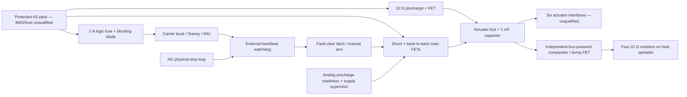

# Conditional M4 power circuit

Recorded 1 October 2026. This is a reviewable circuit and packaging candidate, **not a fabrication release or a qualified AK40 supply**. Native sources are in `electronics/power/`; saved configuration, net/pad checks and experiments are in `artifacts/milestone-4/continuation/`. The exact motor/driver voltage, protocol and torque/current fields remain inhibited in `config/actuator-profile.json`.

## Implemented candidate

| Function | Candidate part | Manufacturer basis |
| --- | --- | --- |
| High-side/precharge/protection controller | TPS48111LQDGXRQ1 | [TI datasheet](https://www.ti.com/lit/ds/symlink/tps4811-q1.pdf), reference circuit Fig. 8-8, latch-off Fig. 8-11 and DGX0019A drawing |
| Main pair, precharge and dump switches | Four AOD4184A, 40 V | [AOS datasheet](https://www.aosmd.com/res/data_sheets/AOD4184A.pdf); 4.5 V gate specification supports the conditional dump model; transient/SOA margins remain open |
| Independent heartbeat supervisor | TPS3431SDRBR | [TI datasheet](https://www.ti.com/lit/ds/symlink/tps3431.pdf), adjustable capacitor timing |
| Arm latch and logic | SN74LVC1G74DCTR, SN74LVC1G17DCKR, SN74LVC1G08DCKR | [Latch](https://www.ti.com/lit/ds/symlink/sn74lvc1g74.pdf), [Schmitt input](https://www.ti.com/lit/ds/symlink/sn74lvc1g17.pdf), [AND](https://www.ti.com/lit/ds/symlink/sn74lvc1g08.pdf). AND inputs tolerate the 5 V readiness pull-up while its supply is 3.3 V |
| Startup supervision | TLV803EB46DCKR and TLV803EA29DCKR | [TI datasheet](https://www.ti.com/lit/ds/symlink/tlv803e.pdf), SC70 pins 1=GND, 2=RESET, 3=VDD. Readiness pull-up follows SAFE5; logic reset clears the latch |
| Bus-powered dump supply | MCP1799-5002H/DB | [Microchip datasheet](https://ww1.microchip.com/downloads/aemDocuments/documents/APID/ProductDocuments/DataSheets/MCP1799-Data-Sheet-20006248B.pdf). 5 V output; selected 4.7 µF ceramics still require effective-capacitance/DC-bias verification |
| Comparator and reference | TLV1702AIDGKR + LM4040A25IDBZR | [Comparator](https://www.ti.com/lit/ds/symlink/tlv1702.pdf), [reference](https://www.ti.com/lit/ds/symlink/lm4040.pdf). Passive hysteresis and explicit reference NC pin |
| External resistors | Five LTO050F22R00JTE3 | [Vishay LTO50](https://www.vishay.com/docs/50050/lto50.pdf). Four parallel dump resistors, one precharge resistor; 50 W requires a 25 °C case, free-air rating is only 2.5 W |
| Current sense | WSL25125L000FEA, 5 mΩ | [Vishay WSL](https://www.vishay.com/docs/30100/wsl.pdf); Kelvin routing and thermal proof still needed |
| Storage | EEUFR1H102, 1,000 µF / 50 V | [Panasonic component](https://na.industrial.panasonic.com/products/capacitors/aluminum-electrolytic-capacitors/aluminum-electrolytic-capacitors-radial-lead-type/series/83367/model/83735); Ø16 × 25 mm, tolerance and pulse/ripple qualification recorded separately |
| Logic branch | 0467001.NR + SS16 | [Littelfuse series](https://www.littelfuse.com/products/fuses-overcurrent-protection/surface-mount-fuses/fast-acting-fuses/467), [Diodes datasheet](https://www.diodes.com/assets/Datasheets/ds23001.pdf). This branch does not protect the whole pack |

The BOM supplies ordering codes for Yageo RC/RT resistors and KEMET ceramic candidates. Manufacturer [X7R](https://content.kemet.com/datasheets/KEM_C1002_X7R_SMD.pdf) and [C0G](https://content.kemet.com/datasheets/KEM_C1003_C0G_SMD.pdf) families are cached. Several exact-part PDF endpoints timed out; distributor availability and ceramic effective capacitance are **not verified**. The initially attempted 39.7 kΩ and 9.89 kΩ ordering codes were not used: the watchdog protection circuit instead uses 39.2 kΩ + 499 Ω; readiness uses 9.76 kΩ. Supply and remote-temperature decoupling are explicit.

## Behavior and limits

The NC stop loop directly controls watchdog EN. Watchdog/stop/protection faults clear the physical arm latch; recovered heartbeat alone cannot rearm it. The manual button uses RC filtering and a Schmitt buffer. Dedicated supply supervisors cover latch startup and the unpowered readiness-comparator case. Sub-POR behavior, button-held/bounce behavior, complete startup sequencing and real cutoff still require bench validation; this model is not a safety certification.

The logic rail is upstream of the main actuator disconnect. The dump comparator and gate pull-up take power from the actuator bus, so loss of MCU power does not intentionally disable braking. The main FET pair shares sources and blocks reverse current when off; the separate precharge path is resistor-limited. Supply supervisors and analog bus readiness prevent a timer-only bypass. The current target emits no heartbeat or motor commands because its profile is unqualified.

The declared electrical test domain is a 25.2 V initial bus receiving **4 A for 100 ms**, with the battery open, 800 µF minimum capacitance, resistor tolerance and assumed response delay. It is not a proven bound on every braking/fall event. Exact transistor, regulator and comparator switching use behavioral models, not manufacturer transistor-level macromodels. The 28 V ceiling is a conditional project target, **not a CubeMars rating**.

Measured results, complete decks and raw traces are in `power/analysis/report.json`. The corner scan and independent analytic delayed-rise bound accompany SPICE, along with low-resistance thermal, 6 A overload, absent clamp, MCU-loss and standby-load cases. The theoretical hundreds-of-volts no-clamp result only detects inadequate energy disposal; physical components would fail much earlier.

The approximately 6.12 A OCP setting is separate from phase current. Its nominal timer is 1.08 ms. Saved locomotion peaks give a conditional 2.40 A DC input overbound under unqualified efficiency/Kt/copper assumptions; full simultaneous effort limits could exceed 17 A from copper loss alone. A real bus-current/thermal limit therefore must constrain operation beyond the accepted trajectory set. Protection resistor tolerances, MOSFET thermal/SOA, shunt Kelvin sensing and real driver currents remain gates.

Native routing demonstrates signal connectivity using 0.15 mm fine-pitch breakouts, a declared 0.15 mm fabrication-clearance assumption and ground fills. It **does not demonstrate adequate high-current copper**, Kelvin paths or gate-loop layout. Routing geometry/DRC must not be used as a current rating. The first wide-trace attempt could not resolve all fine-pitch connections. The revised envelope packing fits, but a new electrical power layout with appropriate power planes, short sense/gate paths and transient suppression is needed before fabrication. 40 V FETs must be reviewed against the eventual clamp and inductive surge bounds.

The 60 °C resistor case bound is an **assumption**. The heat spreader is an envelope and mass provision; no enclosure convection, repetitive-duty or measured contact resistance proves that temperature. Thermal pulse capability, cap ripple and EMI/parasitic inductance remain unqualified.

## Historical stacked packaging

The separate FreeCAD study places native board component envelopes, mounts, connector/insulation allowances, the capacitor and five external resistors. The stacked board/cap arrangement needs 39.32 mm versus a 10 mm allocation and intersects the shell. Estimated combined electronics mass is 96.116 g versus 90 g reserved. The hypothetical 2.49835 kg robot would have only about 1.65 g ceiling margin; that mass was not adopted, and incomplete pack/protection/harness details can consume it.

Next revise packaging within M4: evaluate a separate vertical power board, relocation or splitting of bus capacitance, and a thermally coupled resistor mount. Reconcile the entire pack/BMS/fuse/harness budget before changing the CAD-derived rigid-body masses. Rebuild CAD/mass properties and rerun physical acceptance for any adopted geometry or mass change. M5 should wait for the digital fit/power/application gates to be resolved, with later hardware qualification kept explicit.

## Current packaging checkpoint

The [M4 packaging results](milestones/04-packaging-results.md) record a rear vertical board, horizontal existing capacitor and upper resistor bank. Native envelope clearance and removal sweeps pass; current mass remains 2.494762 kg after explicit pack/electronics/harness reconciliation. The capacitor maximum diameter includes +0.5 mm and LTO50 envelopes include +0.3 mm body tolerances. Capacitance and circuit values are retained, but lead strain, parasitic inductance and the current-rated electrical layout remain open.

The thermal feasibility study predicts about 103°C spreader bulk peak for 10.5 J events every 12 s at declared 45°C internal air and h=5 W/m²K. It does not establish a path to ambient or contact/junction temperature. The 60°C resistor case bound remains unproven. Next develop that heat path, pack protection and the current-rated power layout; do not infer hardware release from envelope fit or connectivity DRC.

## Latest separate protection checkpoint

The [protection results](milestones/04-protection-results.md) extend the unadopted exposed-roof/current-path study with reverse blocking before both branches, ST SMBJ26A/CA clamps, 100 V AOD2910 switch candidates, bus-powered TPS7A16 SAFE5 and a 50 V-input logic buck. The original boards above have not been revised with these substitutions. The separate native module passes ERC/DRC and pin/path checks, but adding it separately yields 2.502935 kg and fails mass. Its functions must be consolidated into the existing allocation with revised ADC/sensing and independent precharge cutoff.

Hot-transient and finite-inductance SPICE screens pass only their declared current, temperature, loop and removal-time domain; a fast/hot/reversed-input corner fails. Startup/thermal/stop-energy calculations and a separate C policy retain the corresponding overload and domain failures. Exact driver/pack data, integrated layout/current/thermal/SOA, calibrated meters/peak capture and bounded disable behavior remain gates. These experiments do not authorize fabrication or real motor operation.
